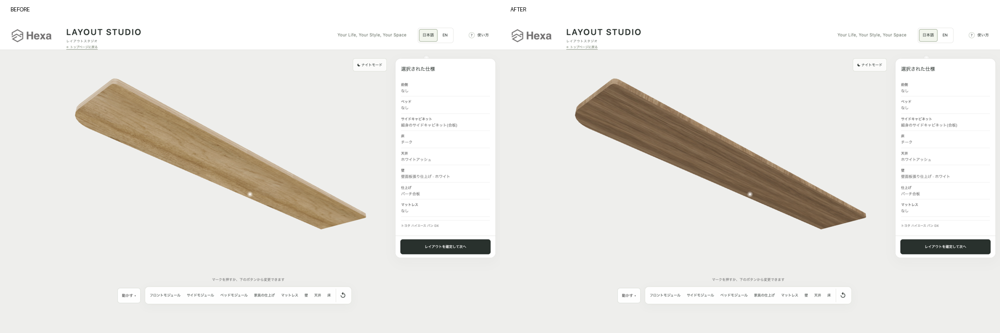
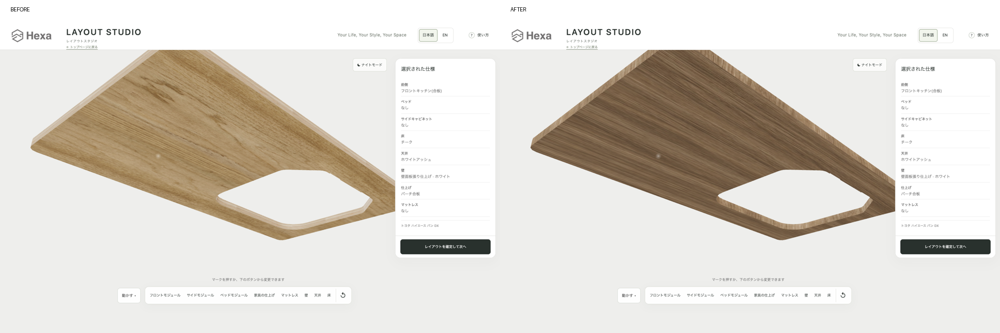
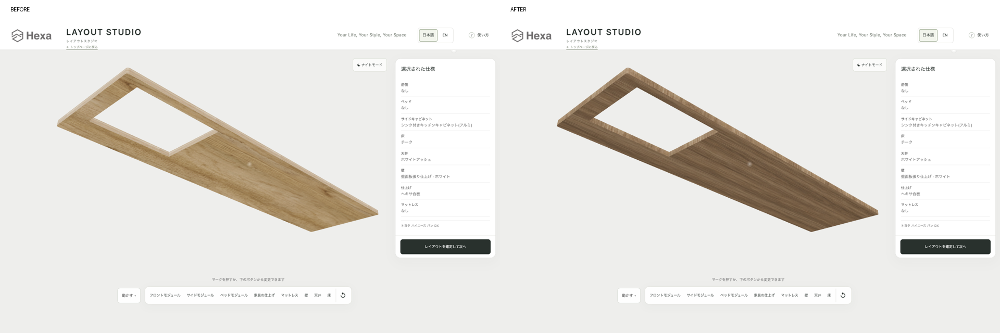

# ALBERO天板の裏面・小口（2026-10-11）

完了：対象10種類の天板を、Hexa・バーチ両仕上げとも部品全体でALBEROにしました。38GLBを別出力し、本番には反映していません。

[前後写真18組](albero-review/比較一覧.html) ／ [修正版38本](shared-textures-albero-20261011-1/assets/blender/)

## 変更と検査

- 変更20GLB、天板20部材（仕上げ別）、42面区分。残り18GLBは全バイト一致。
- 合計 27,601,168 bytes。既存共有WebP5枚をそのまま利用。画像の再生成・再圧縮なし。
- 上面の材質・UV、全形状・法線・位置・AO用UVとAO割当を保持。下面と小口だけ既存ALBERO素材へ変更。小口は厚み方向を含むUVを設定。
- ベッド天板・他の合板・金物と、既存の材質判定規則は変更なし。`countertop_candidate`に該当する部品の全パーツを対象。
- 独立検査38本成功。ブラウザーで38本すべてGLB採用・外接差2mm以内、最大 0.154425301 mm。最終撮影の読込エラー・警告・HTTPエラー0。
- 再実行：`python3 -B scripts/blender-pipeline/repair_albero.py --execute --external-textures --tag albero-20261011-2`（新しい出力名が必要）。

## 前後画像

side-cabinet・front-module・aluminum-side-cabinetの両仕上げ、車内・下から・天板のみの裏面、前後36PNG（1440×900）。比較18PNG（1920×640）。全18組で同一カメラ。

「前」の6GLBは現在の公開URLから取得したものと全バイト一致。UIは作業開始時のローカル採用版を複写して統一し、GLBだけ差し替えています。公開サイトの画面全体を直接撮影した比較ではありません。

細身side-cabinetの扉開閉機能は現行実装にないため、扉を開けた画像は作らず、天板だけを一時表示した裏面画像で確認しました。元の部品の形状・位置は変えていません。

設計データを元にしたイメージです。実際の色・仕様とは細部が異なる場合があります。

### side-cabinet / black

[車内](albero-review/comparison/side-cabinet-black-inside.png) ／ [下から](albero-review/comparison/side-cabinet-black-underside.png)

### side-cabinet / birch

[車内](albero-review/comparison/side-cabinet-birch-inside.png) ／ [下から](albero-review/comparison/side-cabinet-birch-underside.png)

### front-module / black

[車内](albero-review/comparison/front-module-black-inside.png) ／ [下から](albero-review/comparison/front-module-black-underside.png)

### front-module / birch

[車内](albero-review/comparison/front-module-birch-inside.png) ／ [下から](albero-review/comparison/front-module-birch-underside.png)

### aluminum-side-cabinet / black

[車内](albero-review/comparison/aluminum-side-cabinet-black-inside.png) ／ [下から](albero-review/comparison/aluminum-side-cabinet-black-underside.png)

### aluminum-side-cabinet / birch

[車内](albero-review/comparison/aluminum-side-cabinet-birch-inside.png) ／ [下から](albero-review/comparison/aluminum-side-cabinet-birch-underside.png)

## 変更部品一覧

各行ともHexa・バーチの両方。寸法は元データのX/Y/Z、mm。

|モジュール|部品（元番号）|X × Y × Z mm|
|---|---|---|
|front-module|ボディ61（4）|530 × 20 × 930|
|aluminum-front-kitchen|Oak top18mm - revised perimeter and original sink cutout（293）|1527 × 18 × 1079|
|side-cabinet|Side cabinet oak top - 1561x295x20 - R15（20）|295 × 20 × 1561|
|simple-side-cabinet|tennbann（34）|255 × 18 × 1410|
|aluminum-side-cabinet|Oak top1294.8x360x18 - compact sink and centered pump（141）|360 × 18 × 1294.8|
|active-side-cabinet|Oak top652x374x15 - surfaceZ650（35）|374 × 15 × 652|
|front-module-rear-20|ボディ61（4）|530 × 20 × 950|
|front-module-rear-114|ボディ61（4）|530 × 20 × 1044|
|front-module-rear-130|ボディ61（4）|530 × 20 × 1060|
|front-module-rear-140|ボディ61（4）|530 × 20 × 1070|

## 記録・作業範囲

[材質変更の全一覧](shared-textures-albero-20261011-1/material-changes.json) ／ [入力ハッシュと概要](shared-textures-albero-20261011-1/summary.json) ／ [保持検査](albero-review/verification.json) ／ [ブラウザー検査](albero-review/capture-results.json) ／ [本番データ照合](albero-review/production-check.json) ／ [並行変更の記録](albero-review/scope-check.json)

元のlayouts/と8766へ書込なし。並行担当の変更は保持。Blender・Fusion・Chrome起動・push・公開なし。既存Chrome 9222の専用コンテキストと一時8767だけを使用。

初回は小口の別パーツを検出して対象を部品全体へ広げました。初回撮影の未定義視点と複写版の補助CSS/JS不足を直し、最終画像を取り直しています。

次にできること：ジョブズが比較画像を確認し、別作業で修正版を採用する。

一時配信8767は停止確認済み。
