# 両サイドベッドの縁4枚をHexa黒に（2026-10-11）

**完了：指定4枚を黒へ変更し、Pythonだけで38本を別出力。6モジュールの前後比較を保存しました。**

[前後写真の一覧を開く](edge4-review/比較一覧.html) ／ [出力GLB38本](shared-textures-hexafix-20261011-2/assets/blender/)

## 実行結果

- `WOOD_BED_TOPS` のtwo-side-bedだけを空にし、ボディ69・78・214・215を天板例外から外しました。他のベッド天板・ALBERO規則は維持。
- 床スライドの合板135・142・145・146・147・148は既にHexa黒。黒を保持し、金物131〜134と固定レール2本は元材質を保持。131〜148の番号すべてが連番で現れる構成ではありません。
- 実行済み：`python3 -B scripts/blender-pipeline/repair_hexa.py --execute --tag hexafix-20261011-2 --external-textures`。38GLB＋既存共有WebP5枚、合計27,545,444 bytes。画像の再圧縮・Blender起動なし。
- 本番採用データからは10GLB・48面区分・37部材を変更（合板26部材＋誤分類11部材、後端4版の重複込み）。前回`hexafix-20261011-1`との差は`two-side-bed-hexa.glb`のみ。
- サイドキャビネットのHexa版は元から対象面が黒で、今回もバイト一致。冷蔵庫下の幕板51・53も元から黒で保持。冷蔵庫外箱等の修正と区別しました。

## 4枚の寸法

形状・位置は変更していません。元データの外接寸法、mm。

|部品|幅×厚さ×奥行|高さ位置|
|---|---|---|
|ボディ69|83 × 15 × 445|370〜385|
|ボディ78|83 × 15 × 445|370〜385|
|ボディ214|163 × 15 × 509|370〜385|
|ボディ215|213 × 15 × 474|370〜385|

## 比較条件と写真

「前」は作業開始時のhexa-public/layoutsを複写した版に現在の採用GLBを使用。「後」は同じ複写版のGLBだけを差し替えました。比較6本のHexa GLBは公開中の `https://hexamodules.com/layouts/assets/blender/` から取得したデータとSHA-256・全バイト一致（[照合記録](edge4-review/production-check.json)）。公開サイトのUI全体を撮影したものではなく、同じローカル表示条件で素材差を比べています。

PC 1440×900、昼、マットレスなし、各家具単体を車内に配置。サイド・車内・後ろ、6種×2仕上げ×前後＝72PNG。前後のカメラ座標は全36組一致。変更部品が天板・扉に隠れる5種は、他部品を一時非表示にした補助10PNGも保存。材質・形状・位置は元のままです。

設計データを元にしたイメージです。実際の色・仕様とは細部が異なる場合があります。

### フロントキッチン（合板）

冷蔵庫外箱をバーチから元のグレー、操作パネルを元の濃色に修正。幕板・天板は保持。外箱は通常視点で隠れるため補助画像で確認。

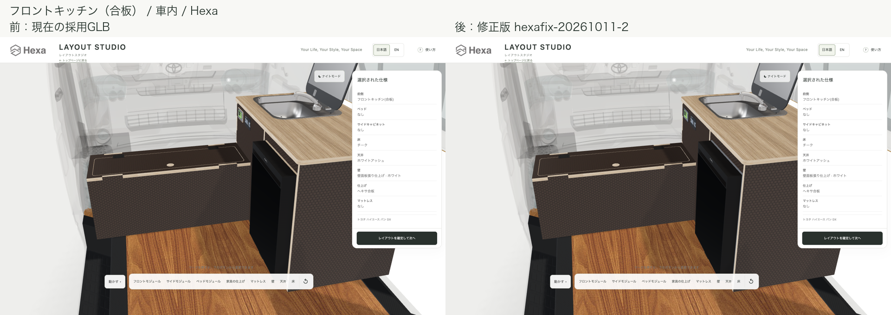

[サイド](edge4-review/comparison/front-module-black-side.png) ／ [後ろ](edge4-review/comparison/front-module-black-rear.png)

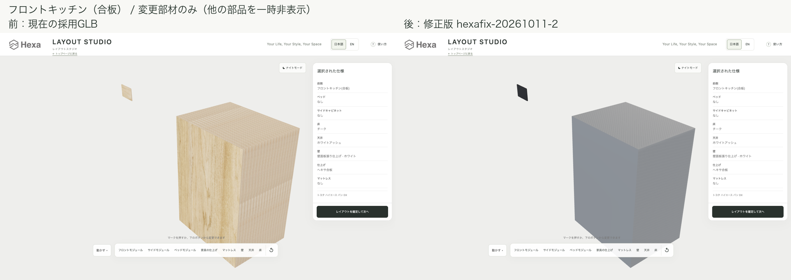

### 両サイドベッド

壁側の水平板4枚がバーチから黒へ。中央床スライドは前後とも黒。小口の積層木目は保持。

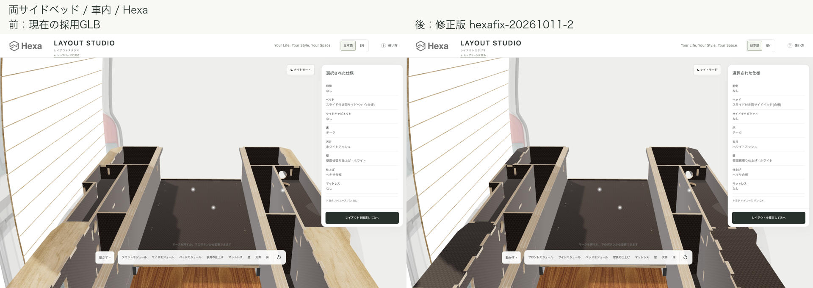

[サイド](edge4-review/comparison/two-side-bed-black-side.png) ／ [後ろ](edge4-review/comparison/two-side-bed-black-rear.png)

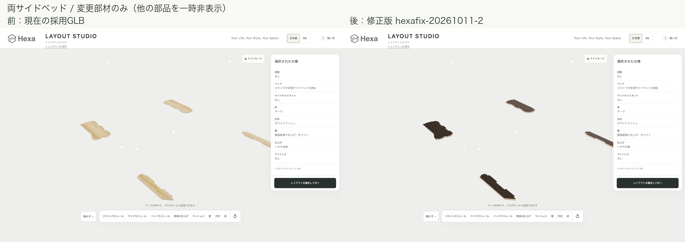

### サイドキャビネット

今回の素材変更なし。3方向とも3D領域は画素一致。ALBERO天板は木目を維持。

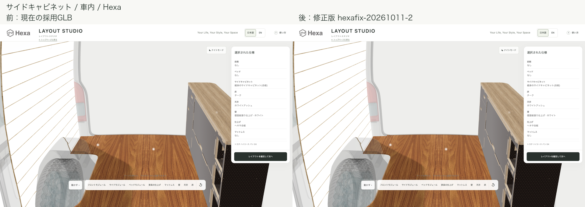

[サイド](edge4-review/comparison/side-cabinet-black-side.png) ／ [後ろ](edge4-review/comparison/side-cabinet-black-rear.png)

### ラウンジベッド

収納内部と扉の合板9部材を黒へ。寝面の7天板はバーチを維持。通常画像の差は小さく、補助画像で内部を確認。

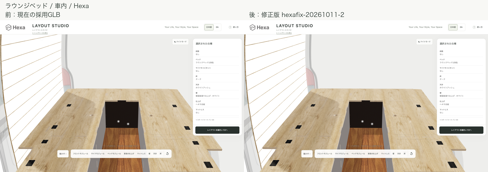

[サイド](edge4-review/comparison/lounge-bed-black-side.png) ／ [後ろ](edge4-review/comparison/lounge-bed-black-rear.png)

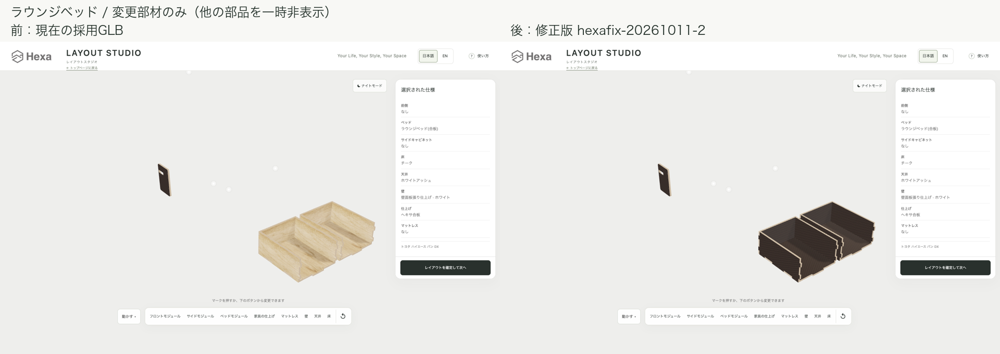

### ラウンジスライドベッド

引き出し・支持板等10部材を黒へ。6天板はバーチを維持。収納状態の3方向は3D領域画素一致で、補助画像で黒化を確認。

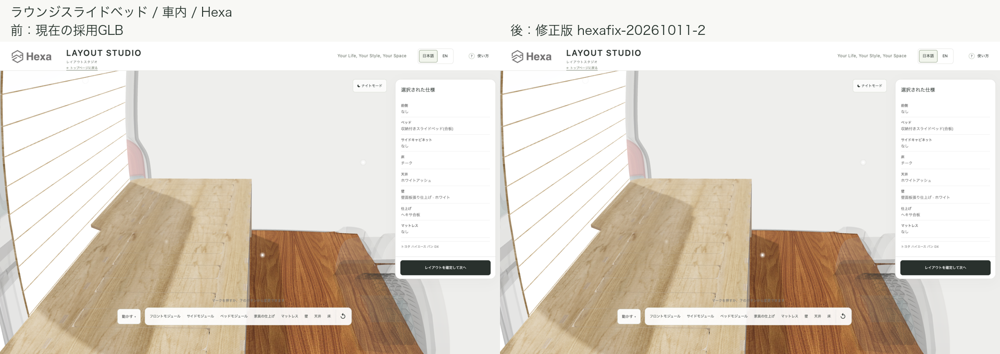

[サイド](edge4-review/comparison/lounge-slide-bed-black-side.png) ／ [後ろ](edge4-review/comparison/lounge-slide-bed-black-rear.png)

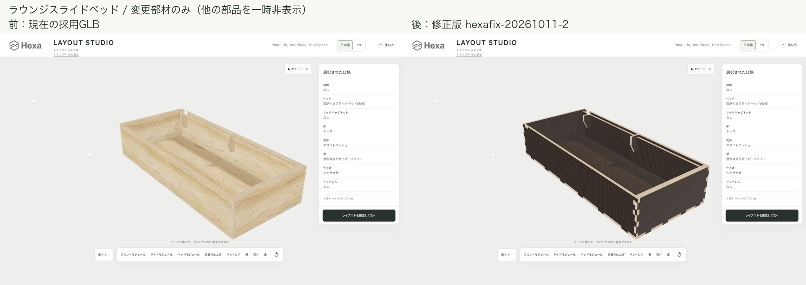

### フロントキッチン（アルミ）

内部合板3部材に残ったバーチ面区分を黒へ。天板・アルミ・コンテナ・冷蔵庫扉は保持。主要面は元から黒で、通常画像・補助画像とも差はごく小さいため、3部材の材質割当でも修正を確認しました。

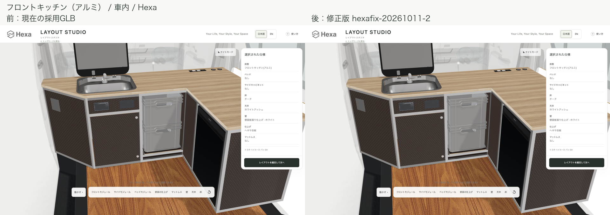

[サイド](edge4-review/comparison/aluminum-front-kitchen-black-side.png) ／ [後ろ](edge4-review/comparison/aluminum-front-kitchen-black-rear.png)

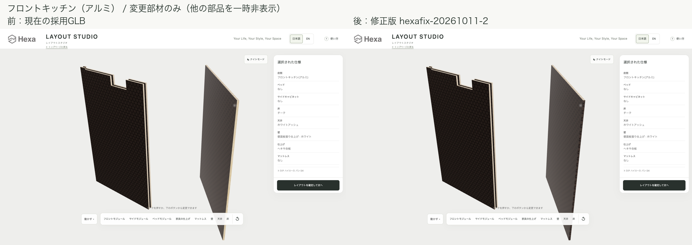

## 検査・保持

- 実データ20検査が合格（Hexa修正4、天板5、ALBERO4、材質7）。38本を再復号し、6,246面区分・976,608 UV頂点を検証。位置・法線・AO用UV、既存圧縮形状と画像を保持。
- ブラウザーでも38本すべてGLB採用・2mm以内。元形状との外接最大差0.154425301mm。最終撮影の読込エラー・GLB警告・HTTPエラー0。
- Birch19本は全バイト一致。比較6種×3方向の3D領域（ヘッダー下y=84以降）は全18組で画素差0。スクリーン全体には各642画素の微差があり、すべてヘッダー左上のロゴ範囲x34〜147/y25〜60に限定。
- 天板例外に残る部材とALBERO天板は材質・面割当・形状を維持。元の共有WebP5枚も全バイト一致。
- 仮配信フォルダ内のlayoutsは開始時の複写版に対して10GLBのみ差分。元layouts/assetsは開始時と一致。元layoutsには並行担当によるJS4ファイルの変化があり、当作業からは書込・巻戻し・コミットしていません。
- Chromeは既存9222へ接続し、専用の一時コンテキストのみ使用。8767サーバーを停止済み。8766サーバーは操作なし。Blender・Fusion・git push・公開操作なし。
- 初回の仮配信で不足した親フォルダのmodules.json・見本画像を複写し、最終撮影をやり直しました。元のlayoutsへの修正はしていません。

## 成果物

- [写真一覧](edge4-review/比較一覧.html)：通常36組＋補助5組、計41枚の左右比較。元PNG82枚（1440×900）、比較PNG41枚（1920×680）。
- [出力一覧と入力ハッシュ](shared-textures-hexafix-20261011-2/summary.json) ／ [全材質記録](shared-textures-hexafix-20261011-2/material-changes.json)
- [ブラウザー検査](edge4-review/capture-results.json) ／ [部品表示検査](edge4-review/parts-results.json) ／ [画素比較](edge4-review/pixel-comparison.json)
- [復号検査](edge4-review/decoded-validation.json) ／ [保持検査](edge4-review/verification.json) ／ [作業範囲](edge4-review/scope-check.json) ／ [サーバー停止](edge4-review/server-stop.json)

次にできること：ジョブズが比較写真を確認し、別作業で修正版38本を本番のlayoutsへ反映する。今回の採用先は仮配信フォルダだけです。

## 変更部材の全一覧

寸法はX/Y/Zの外接寸法。元番号は配列の0始まり番号で、部品名中の番号とは別です。

|モジュール|部品名（元番号）|寸法 X/Y/Z mm|変更|
|---|---|---|---|
|front-module|Cabinet envelope - rear top relief approximate（10）|290.0 / 517.0 / 380.0|バーチ表現 → 元のグレー（外箱）|
|front-module|Front bezel 99x61 - mounting underside Z0（41）|2.9 / 61.0 / 99.0|バーチ表現 → 元の濃色（操作パネル）|
|aluminum-front-kitchen|pannel (4)（12）|290.5 / 542.0 / 290.5|バーチ表現 → Hexa黒面（小口保持）|
|aluminum-front-kitchen|Sink clearance - pannel (9) - faucet fitting clearance80mm（21）|330.0 / 542.0 / 6.5|バーチ表現 → Hexa黒面（小口保持）|
|aluminum-front-kitchen|Sink clearance - pannel (10) - faucet fitting clearance80mm（22）|330.0 / 542.0 / 6.5|バーチ表現 → Hexa黒面（小口保持）|
|aluminum-side-cabinet|Front bezel 99x61 - mounting underside Z0（15）|2.9 / 61.0 / 99.0|バーチ表現 → 元の濃色（操作パネル）|
|lounge-slide-bed|Birch central support - reference chamfer（23）|75.0 / 120.0 / 15.0|バーチ表現 → Hexa黒面（小口保持）|
|lounge-slide-bed|Birch drawer bottom -15mm tab joints（14）|526.0 / 15.0 / 1188.0|バーチ表現 → Hexa黒面（小口保持）|
|lounge-slide-bed|Birch drawer front box end（17）|526.0 / 239.0 / 15.0|バーチ表現 → Hexa黒面（小口保持）|
|lounge-slide-bed|Birch drawer rear box end（18）|526.0 / 239.0 / 15.0|バーチ表現 → Hexa黒面（小口保持）|
|lounge-slide-bed|Birch drawer side - aisle（15）|15.0 / 239.0 / 1188.0|バーチ表現 → Hexa黒面（小口保持）|
|lounge-slide-bed|Birch drawer side - wall（16）|15.0 / 239.0 / 1188.0|バーチ表現 → Hexa黒面（小口保持）|
|lounge-slide-bed|Birch front top support - tab joints（22）|526.0 / 120.0 / 15.0|バーチ表現 → Hexa黒面（小口保持）|
|lounge-slide-bed|Birch rear support - reference chamfer（24）|75.0 / 107.0 / 15.0|バーチ表現 → Hexa黒面（小口保持）|
|lounge-slide-bed|Birch top ledge - aisle（25）|15.0 / 25.0 / 1143.0|バーチ表現 → Hexa黒面（小口保持）|
|lounge-slide-bed|Birch top ledge - wall（26）|15.0 / 25.0 / 1143.0|バーチ表現 → Hexa黒面（小口保持）|
|lounge-bed|ボディ217（69）|339.5 / 181.0 / 12.0|バーチ表現 → Hexa黒面（小口保持）|
|lounge-bed|ボディ224（70）|339.5 / 181.0 / 12.0|バーチ表現 → Hexa黒面（小口保持）|
|lounge-bed|ボディ235（71）|12.0 / 181.0 / 414.0|バーチ表現 → Hexa黒面（小口保持）|
|lounge-bed|ボディ237（72）|12.0 / 181.0 / 414.0|バーチ表現 → Hexa黒面（小口保持）|
|lounge-bed|ボディ238（73）|12.0 / 181.0 / 414.0|バーチ表現 → Hexa黒面（小口保持）|
|lounge-bed|ボディ240（74）|12.0 / 181.0 / 414.0|バーチ表現 → Hexa黒面（小口保持）|
|lounge-bed|ボディ244（75）|339.5 / 12.0 / 414.0|バーチ表現 → Hexa黒面（小口保持）|
|lounge-bed|ボディ248（76）|339.5 / 12.0 / 414.0|バーチ表現 → Hexa黒面（小口保持）|
|lounge-bed|扉 (1)（1）|15.0 / 256.0 / 196.0|バーチ表現 → Hexa黒面（小口保持）|
|two-side-bed|ボディ69（21）|83.0 / 15.0 / 445.0|バーチ表現 → Hexa黒面（小口保持）|
|two-side-bed|ボディ78（23）|83.0 / 15.0 / 445.0|バーチ表現 → Hexa黒面（小口保持）|
|two-side-bed|ボディ214（40）|163.0 / 15.0 / 509.0|バーチ表現 → Hexa黒面（小口保持）|
|two-side-bed|ボディ215（41）|213.0 / 15.0 / 474.0|バーチ表現 → Hexa黒面（小口保持）|
|front-module-rear-20|Cabinet envelope - rear top relief approximate（10）|290.0 / 517.0 / 380.0|バーチ表現 → 元のグレー（外箱）|
|front-module-rear-20|Front bezel 99x61 - mounting underside Z0（41）|2.9 / 61.0 / 99.0|バーチ表現 → 元の濃色（操作パネル）|
|front-module-rear-114|Cabinet envelope - rear top relief approximate（10）|290.0 / 517.0 / 380.0|バーチ表現 → 元のグレー（外箱）|
|front-module-rear-114|Front bezel 99x61 - mounting underside Z0（41）|2.9 / 61.0 / 99.0|バーチ表現 → 元の濃色（操作パネル）|
|front-module-rear-130|Cabinet envelope - rear top relief approximate（10）|290.0 / 517.0 / 380.0|バーチ表現 → 元のグレー（外箱）|
|front-module-rear-130|Front bezel 99x61 - mounting underside Z0（41）|2.9 / 61.0 / 99.0|バーチ表現 → 元の濃色（操作パネル）|
|front-module-rear-140|Cabinet envelope - rear top relief approximate（10）|290.0 / 517.0 / 380.0|バーチ表現 → 元のグレー（外箱）|
|front-module-rear-140|Front bezel 99x61 - mounting underside Z0（41）|2.9 / 61.0 / 99.0|バーチ表現 → 元の濃色（操作パネル）|
