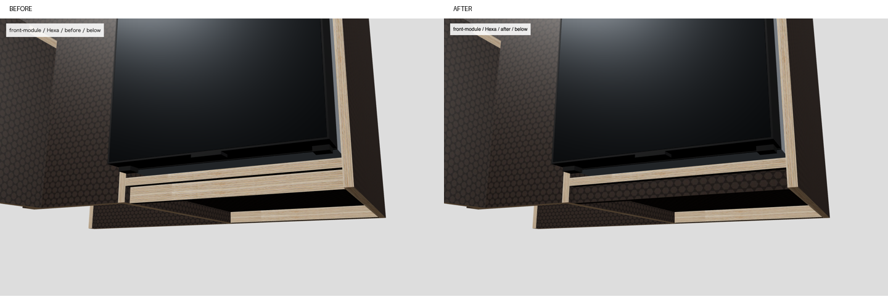
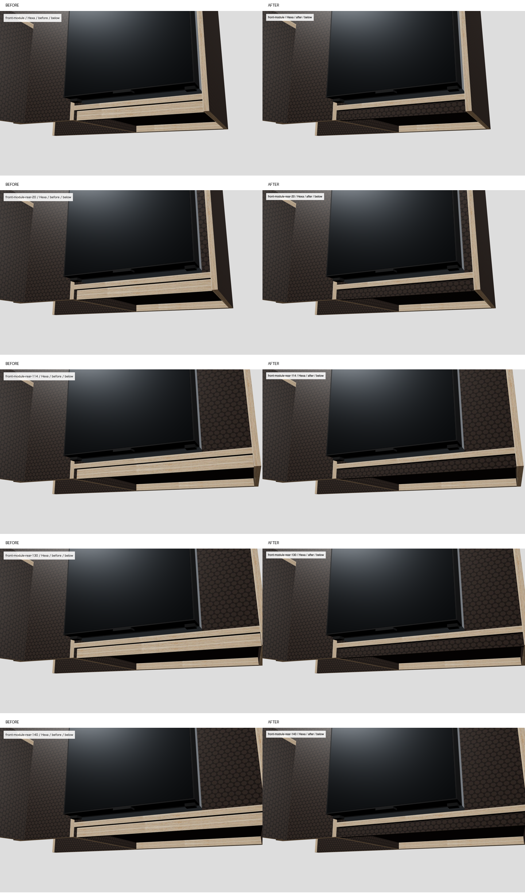

# 冷蔵庫下の幕板（2026-10-11）

原因を特定し、修正版38GLBを別出力しました。本番への反映はしていません。

[前後写真25組](fridge-apron-review/比較一覧.html) ／ [全60プリミティブ表](fridge-apron-review/全プリミティブ表.md) ／ [修正版38本](shared-textures-hexafix-20261011-3/assets/blender/)

## 原因

SHOさんの指摘は `ボディ51` 内の縦幕板でした。ノード `ボディ51_1`、元部材番号0・パーツ1・primitive 0に、正しい小口と、誤って小口扱いされた幕板の表裏が混在しています。冷蔵庫の外箱の色が原因ではありません。

この部材は外接495×45×390mmの段付き形状です。高さ45mm全体を板厚と見なし、最短軸Yに垂直な面だけを板面、それ以外を小口に分類したため、厚15mm・高さ30mmの縦幕板の表裏まで小口画像になっていました。前回は「Hexa面＋小口」という材質名の確認で止まり、小口がどの面に貼られているかを見落としていました。

幕板の通路側はX=−205、裏はX=−220、床からY=0〜30mm。基本形は幅Z=1935〜2325（390mm）。外箱下端はY=58、幅Z=1940〜2320（380mm）。幕板は冷蔵庫幅より左右5mmずつ広く、指摘領域に一致します。

## UVと修正内容

- 変更前：`edge-birch`（小口画像）。基本形の幕板1面390×30＝11,700mm²に、U約1.3・V約2.0。15mm小口画像が高さ方向に2回繰り返され、幅広い明るい帯として見えていました。
- 変更後：幕板の表裏4三角形を分離して既存 `hexa-studio` を割当。Y/Zの縦面に90×90mmで貼付。U約4.333・V約0.333、潰れたUVなし。復号後の両面面積23,401.055mm²（圧縮による微差）、面積/UV面積は8,100mm²。
- その上の15mm厚の水平板の小口、端の小口、後ろの支持部の小口は元のままです。写真に残る細い木色の線はこの正しい小口です。
- 元の頂点・法線・位置・形状・AO用UVとAO割当を保持。影の画像と共有5画像は再生成・再圧縮していません。Hexa材質を複写し、元の小口側のAO割当を引き継ぎました。
- `materials.json` に部材名・パーツ・位置・寸法で限定した幕板規則を追加。`repair_hexa.py` で該当三角形だけ分離します。天板ALBERO・ベッド天板・その他の既存分類規則は変更していません。

|対象Hexa版|幕板 幅×高さ×厚さ mm|変更|
|---|---|---|
|front-module|390×30×15|表裏4三角形|
|front-module-rear-20|410×30×15|同上|
|front-module-rear-114|504×30×15|同上|
|front-module-rear-130|520×30×15|同上|
|front-module-rear-140|530×30×15|同上|

## 確認結果

- 公開URLから取得した基本形＋後端4版は、比較前のローカル5GLBと全バイト一致。[照合記録](fridge-apron-review/production-check.json)
- 38本中、変わったのは上表の5本のみ。残る33本（Birch全19本を含む）は全バイト一致。既存共有画像5枚も全バイト一致。[独立検査](fridge-apron-review/verification.json)
- 変更は合計5部材・20三角形。元の三角形を残り小口と幕板に分けただけで、欠落・重複・形状変更なし。ALBERO、冷蔵庫、ベッドなど他のプリミティブは全て同一。
- 実行した指示：`python3 -B scripts/blender-pipeline/repair_hexa.py --execute --tag hexafix-20261011-3 --external-textures`。GLB＋共有画像合計27,608,576 bytes（前版より7,408 bytes増）。既存出力は上書き不可。
- 基本形＋後端4版×全体・通路側・斜め下・真正面・低い視点の計25条件。前後50PNG（各1440×900）・比較25PNG、全条件で同じカメラと照明。ページエラー・HTTPエラー0。家具単体の検査表示で、車内全体のスタジオ画面ではありません。[変更前記録](fridge-apron-review/before-capture.json) ／ [変更後記録](fridge-apron-review/after-capture.json)
- 再修正しても全5版がバイト一致で、二重分離しないことを確認。[再実行検査](fridge-apron-review/idempotence.json)

設計データを元にしたイメージです。実際の色・仕様とは細部が異なる場合があります。

## 保存と作業範囲

`layouts/`、本物の配信8766、Fusionには変更なし。Blender・Chrome起動、git push、公開なし。既存Chrome 9222に専用の検査接続を作り、一時配信8767を使いました。並行担当の変更・コミットは保持しています。

初回の影割当を引き継がない試作は `fridge-apron-review/draft-without-edge-ao/` に別名保管し、上記の最終出力には含めていません。最終写真はAO引継ぎ版で撮り直しました。

一時配信8767は停止確認済み。一般の素材判定7検査も合格。

次にできること：ジョブズが比較写真を確認し、別作業で修正版を採用する。
